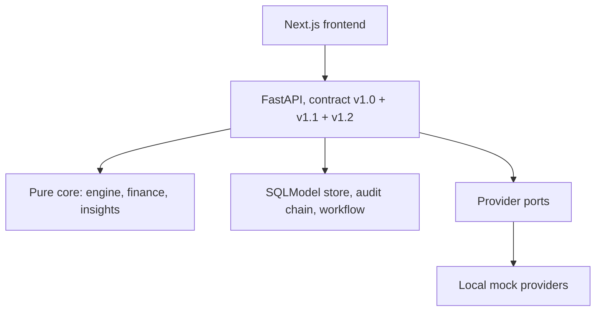

# SamadhaanOS

SamadhaanOS is a legal and accounting workspace for Indian micro and small suppliers who are
paid late. It works out whether the MSMED Act applies to an invoice, when payment was legally
due, how much interest has accrued, what the delay costs the buyer, and what to say next. The
supplier reviews every draft and sends it from their own phone or mail client.

Srujana Tech Fest 2026, Legal Services track, problem statement LS-03.

Status: working prototype. The legal engine, HTTP API, store, customer book, CSV import,
document drafts and frontend run end to end. Eight independent tests currently fail; each is a
recorded finding and none is hidden. They are listed in [Known limitations](#known-limitations).
The full project report is in [`REPORT.md`](REPORT.md).

---

## Quick start

Requires Python 3.11+ and Node 20+.

```bash
pip install -r requirements.txt
npm --prefix frontend install

make seed-history    # demo book: 6 customers, 41 invoices, 29 payments
make dev             # API on :8000, mock providers on :8100, frontend on :3000
```

Open <http://localhost:3000>. API documentation is at <http://localhost:8000/docs>.

To include the original preset cases as well:

```bash
make db-reset        # presets plus the same seeded book: 51 cases, 16 customers
```

Both targets recreate `data/samadhaan.db`. They are destructive by design and only touch demo
data.

---

## What it does

1. **Eligibility first.** A gate checks enterprise class, the Silpi chronology, the trader
   exclusion and the activity match. A blocked case shows why it is blocked, points to the
   civil route, and displays no money at all.
2. **Payment clock.** Acceptance is anchored on delivery, not the invoice date. Written
   objections inside the window are applied; late or unwritten complaints do not pause the
   clock. Agreed credit is capped at 45 days and the clamp is shown.
3. **Interest.** Three times the RBI Bank Rate, with monthly rests, rate changes split into
   segments, part payments treated as rest boundaries, and every row rounded to the paisa.
   Each result cites the rule it came from.
4. **Buyer cost.** Permanent loss, the 43B(h) deduction timing, and the s.22 disclosure duty
   are reported as three separate lines. They are never added together.
5. **Two options.** Get paid early through a simulated TReDS-style flow, or recover through a
   four stage escalation ladder. The API never recommends one over the other.
6. **Drafts.** Acceptance note, memo for the buyer's finance team, settlement term sheet, and
   an evidence pack with a portal checklist. Stage 4 is a checklist, never a fabricated
   official form.
7. **Customer book.** Invoices group into customers by PAN. Two registrations with the same
   PAN are one legal entity; different PANs are only ever linked as a group by the owner.
   Payment history is described with sample sizes, not scored.
8. **Past invoices.** A CSV importer previews every row, then commits through the same code
   path as a single case, so the engine, the customer resolver and the payment route all run.

Nothing is sent automatically. No legal figure is produced by a language model.

---

## How the calculation works

| Rule | Implementation |
|---|---|
| Acceptance | `delivery_date`, or the resolved objection date when a written objection was raised inside the window |
| Credit period | `min(agreed_days, credit_cap_days)` with no exemptions; 15 days when there is no written agreement |
| Interest | Monthly rests from the appointed day, three times the Bank Rate, segmented by rate epoch, reconciled row by row |
| Rounding | Half up to 0.01 at every ledger row so the rows sum to the total |
| Limitation | Runs from the due date; only a signed confirmation or a part payment restarts it |
| Money | `Decimal` throughout, serialised as strings, stored as TEXT |

Statutory values live in `backend/config/statute_config.json` with a `source_ref` and a
`verified` flag. Where a value is unverified or an interpretive question is open, the API
returns an assumption or a warning and the interface shows it.

`docs/statute-sheet/CHECKLIST.md` records which primary sources have been captured. None are
captured yet, so the money surface is provisional by construction.

---

## Screens

| Route | Purpose |
|---|---|
| `/` | Dues, opening on Customers: portfolio cards, duplicates banner, sortable book, expandable groups |
| `/customers/[id]` | Profile: identity, GSTINs, payment history chart, invoices, timeline, payments, buyer cost for one invoice |
| `/customers/review` | Suggestions: attach a provisional record, link two companies as a group, or dismiss, each with undo |
| `/import` | CSV preview table, then commit and results |
| `/case/[id]` | Gate verdict, dates, ledger, buyer cost, defenses, limitation, readiness, options |
| `/case/[id]/early` | Early payment flow with simulated financing |
| `/case/[id]/send/[stage]` | Draft preview and hand-off to WhatsApp or mail |
| `/case/[id]/pack` | Evidence pack and portal checklist |
| `/upload`, `/eligibility/[id]` | Extraction with human confirmation; eligibility explanation |

The interface can run offline against generated fixtures and labels the data source when it
does. Every status is shown with an icon and text, not colour alone.

---

## API

43 paths, 153 schemas. The OpenAPI document in `contracts/openapi.json` is the source of
truth; the TypeScript types in `contracts/types.ts` are generated from it.

Contract versions:

- **v1.0** is frozen. Evaluation, settlement simulation, artifacts, extraction, config and
  presets.
- **v1.1** is additive. Stored cases, tracks, options, financing, recovery, webhooks.
- **v1.2** is additive. Customer book, groups, insights, payments, CSV import.

After a contract change run `make openapi` and `make types` to refresh `contracts/openapi.json`
and `contracts/types.ts`; `make test` fails if the committed document drifts from the app.

Areas:

| Area | Paths |
|---|---|
| Evaluation | `/evaluate-case`, `/simulate-settlement`, `/generate-artifact`, `/extract-evidence` |
| Cases | `/cases`, `/cases/{id}`, `/cases/{id}/events`, `/cases/{id}/events/verify`, `/cases/{id}/stream` |
| Options | `/cases/{id}/options`, `/cases/{id}/financing*`, `/cases/{id}/recovery*` |
| Payments | `/cases/{id}/payments`, `/cases/{id}/payments/{payment_id}/void` |
| Customers | `/customers`, `/customers/{id}`, `/customers/suggestions`, attach, detach, GSTIN links, `/customer-groups*` |
| Portfolio | `/insights` |
| Import | `/import/invoices?mode=preview` and `?mode=commit` |
| Simulator | `/webhooks/esign`, `/webhooks/marketplace`, `/webhooks/disbursement`, `/mock/clock*` |

Owner actions (payments, customer links, groups, financing, recovery) require an
`Idempotency-Key`; a replay returns the stored response and a changed body under the same key
is rejected. Webhooks are verified over raw bytes before the body is parsed. Case level changes
append to that case's hash chain, which can be verified per case.

---

## Architecture



- `backend/engine/` holds the legal rules. Pure functions, no I/O, no clock, no network.
- `backend/finance/` holds financing arithmetic. Pure functions, `Decimal` only.
- `backend/insights/` holds customer identity, payment statistics and portfolio views. Pure
  functions; never recomputes interest or due dates.
- `backend/store/` persists engine input and output, customers, payments, tracks and the
  audit chain. Money is TEXT.
- `backend/workflow/` holds the two state machines and track locking.
- `backend/adapters/` and `mock_providers/` provide the simulated integrations. The app
  refuses to start in production with a mock adapter.
- `frontend/` is a Next.js App Router application that formats what the API returns.

Design notes and traps are in [`architecture.md`](architecture.md) and
[`docs/architecture_v4_two_options.md`](docs/architecture_v4_two_options.md).

---

## Testing

```bash
make test           # spec, contract, dev and mock provider suites
make test-v4        # store, API, workflow, webhooks and finance
npm --prefix frontend run typecheck
npm --prefix frontend run lint
npm --prefix frontend run i18n:check
npm --prefix frontend run build
npm --prefix frontend run smoke     # with the app running
```

Current results:

| Suite | Result |
|---|---|
| `backend/tests/spec` (independent author, hand computed) | 53 pass, 7 fail |
| `backend/tests/contract` | 257 pass, 1 fail |
| `backend/tests/dev` | 1,332 pass |
| `mock_providers/tests` | 65 pass |
| Frontend | 41 routes pass smoke; typecheck, lint, i18n and build are clean |

The eight failures are findings in the engine and contract, not flaky tests. They are listed
in [`docs/test-oracles.md`](docs/test-oracles.md) and
[`docs/review-2026-10-25.md`](docs/review-2026-10-25.md).

---

## Known limitations

1. **Eight failing tests.** Enterprise class is taken from the stated class rather than the
   configured limits; the Silpi chronology check does not compare dates; a payment on a rest
   day that is also the calculation date is mishandled; duplicate payments and a negative
   credit period are accepted; a calculation date before delivery returns 200; `late_complaints`
   follows input order; and the matching Silpi contract edge.
2. **No primary sources captured.** All eleven items in the statute checklist are still
   `captured: no`, so every statutory constant is unverified and the money surface is
   provisional.
3. **Interpretive questions are surfaced, not settled.** Whether a purchase order counts as a
   written agreement, the Silpi anchor date, the interest appropriation order and the
   financier's enforcement position are open questions shown on screen.
4. **Financing is simulated.** eSign accepts a test OTP only. Bids come from fictional
   financiers. No Aadhaar number is collected, stored or logged.
5. **Nothing is sent.** The app produces `wa.me` and `mailto:` links. There is no server side
   dispatch, delivery receipt or scheduling.
6. **No filing or representation.** Stage 4 is a checklist and evidence bundle.
7. **Kannada covers the owner facing cards only** and has not been reviewed by a native
   speaker.
8. **GSTIN validation checks format only.** The check digit is not verified and no portal
   lookup is made.
9. **Not covered:** medium enterprises, traders, court filings, legal representation.
10. **No authentication.** The store is single owner and defaults to local SQLite.

---

## Configuration

Copy `.env.example` to `.env` and edit locally. The file is git ignored; no secret is required
for the offline demo.

| Variable | Purpose |
|---|---|
| `APP_ENV` | `development` by default. In `production` the app refuses to start with mock adapters |
| `PROVIDER_MODE` | `mock` (default) or `live` |
| `DATABASE_URL` | Defaults to `sqlite:///./data/samadhaan.db`; the schema is Postgres compatible |
| `MOCK_PROVIDERS_URL` | Base URL of the local simulator |
| `MOCK_CLOCK` | Set to `1` to enable the simulated clock and `/mock/clock` |
| `WEBHOOK_SECRET_ESIGN`, `WEBHOOK_SECRET_MARKETPLACE`, `WEBHOOK_SECRET_DISBURSEMENT` | HMAC secrets per provider; local placeholders only |
| `IMPORT_TOKEN_SECRET` | Signs CSV preview tokens; required in production |
| `STRICT_VERIFIED` | Set to `1` to turn unverified statute constants into errors |

---

## Demo data

- `backend/presets/case_01.json` to `case_09.json`, ten files including `case_05a` and
  `case_05b`: input only cases used by the judge console and the frontend fixtures.
- `sample-data/invoice_history_template.csv` and `invoice_history_demo.csv`: import samples.
- `sample_data/`: synthetic purchase orders, GST invoices, delivery challans, goods receipts
  and chat exports, including scanned and photographed variants.

All names, GSTINs, Udyam numbers and phone numbers are synthetic.

---

## Project layout

```
backend/        engine, finance, insights, store, workflow, adapters, app, artifacts, tests
contracts/      openapi.json, types.ts, fixtures (v4 and v5 samples)
frontend/       Next.js app, components, lib, generated contract types
mock_providers/ local simulation service with signed webhooks
docs/           architecture notes, open questions, oracles, dependencies, worklog
sample_data/    synthetic document corpus
```

---

## AI assistance

Parts of the codebase were written with coding agents under written role rules in
[`AGENTS.md`](AGENTS.md), with a human making every legal and product decision. The engine is
deterministic and contains no model call and no network access. The work log, including each
agent task and its result, is in [`docs/worklog.md`](docs/worklog.md).

---

## Team

**404BrainNotFound**

- Aniruddha Bhide: backend, legal rules, contract, store, workflow, insights, importer, seed.
- Sanay Krishna: frontend, interaction design, charts, import screen, i18n, accessibility,
  build and smoke tooling.

Further documents: [`REPORT.md`](REPORT.md) (project report), [`architecture.md`](architecture.md)
(system design), [`docs/open-questions.md`](docs/open-questions.md) (open legal questions),
[`docs/test-oracles.md`](docs/test-oracles.md) (test findings),
[`docs/dependencies.md`](docs/dependencies.md) (libraries and their constraints).

This is decision support, not legal advice.
