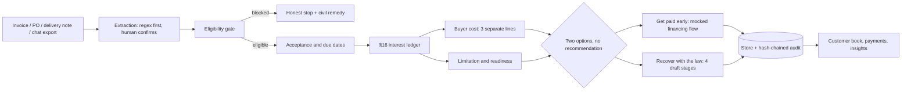
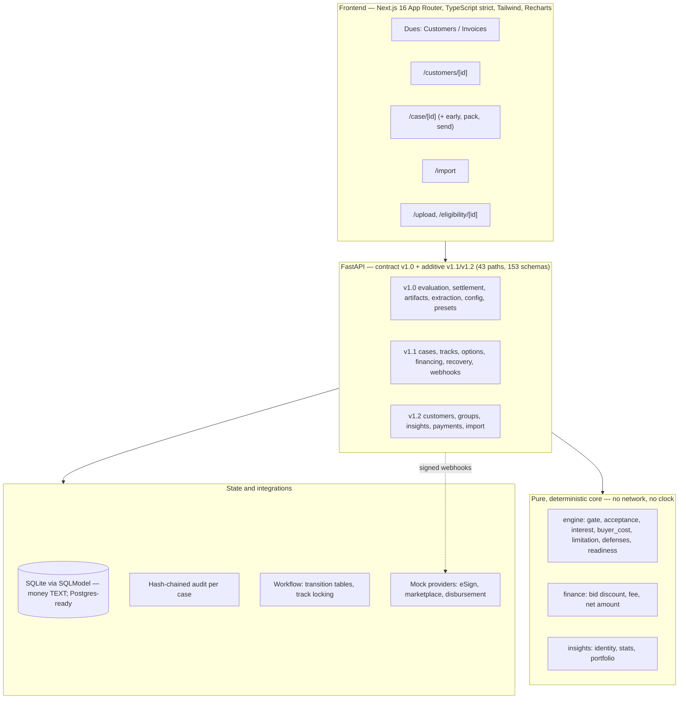

# SamadhaanOS — Project Report

**Enforce without enmity: turning an unpaid invoice into a clock, a number, a record and a graduated ask.**

| | |
|---|---|
| **Project title** | SamadhaanOS — MSME payment-rights workspace |
| **Team name** | 404BrainNotFound |
| **Team members** | Aniruddha Bhide (backend, legal rules) · Sanay Krishna (frontend, UX) |
| **Theme / track** | Srujana Tech Fest 2026 — **Legal Services** |
| **Official problem statement** | **LS-03** — enforcing micro and small suppliers' payment rights under the MSMED Act, 2006 |
| **Repository** | <https://github.com/ANIMANxd/Srujana_hackathon2026_samaadhanos> (branch `v5_customer`) |
| **Status** | Working prototype: engine, API, store, frontend, document drafts, CSV import and portfolio insights run end to end. Eight independent tests are red on purpose and are listed in §11. |

> **A note on names:** early team notes call the frontend owner "Mochi". That is Sanay Krishna's working alias; this report uses full names.

---

## 1. Project overview

### Executive summary

An Indian micro or small supplier delivers goods, raises an invoice, and then waits. The
buyer pays late — often very late — and the supplier has three problems at once: no money,
no affordable way to enforce the payment, and a customer relationship they cannot afford to
burn.

Indian law is unusually specific about this. The MSMED Act, 2006 fixes when the payment
clock starts (acceptance, not the invoice date), caps agreed credit at 45 days, and adds
compound interest at three times the RBI Bank Rate for every day of delay (§16). The
buyer's own tax position is affected too (deduction timing under §43B(h), disclosure under
§22). The law is strong; the supplier's position is weak, because proving all of that needs
a lawyer, records and leverage.

SamadhaanOS turns the statute into software the owner can operate alone:

1. **Is the Act even available here?** A gate answers first — before any money is shown.
2. **When was the payment due?** Dates are fixed from delivery, with the 45-day cap applied
   and *shown*.
3. **How much is owed?** A day-by-day, rate-by-rate interest ledger, every row cited.
4. **What does the delay cost the buyer?** Three separate lines, never one convenient total.
5. **What do I say, and how far do I escalate?** Four drafted stages, each approved by the
   owner and sent by the owner.
6. **What is my book doing?** A customer book with payment history, an importer for past
   invoices, and descriptive portfolio insights.

Nothing is auto-sent, nothing is auto-merged, no legal number is produced by an LLM, and
every mocked integration is labelled as a simulation.

### What is genuinely demonstrated

| Demonstrated, end to end | Simulated or deliberately absent |
|---|---|
| Eligibility gate, acceptance/due dates, §16 interest ledger, buyer-cost lines, limitation clock, readiness, defenses | Primary-source statute captures (all 11 checklist items are still `captured: no`) |
| Stateless evaluation, stored cases, tracks, audit chain, payments, customer book, CSV import, insights | Real eSign, real TReDS, real bank disbursement (local mocks with fictional parties) |
| Four artifact drafts (markdown + PDF) | Sending: the owner sends from their own WhatsApp/mail app |
| Mock financing flow with signed webhooks and a state machine | Filing on the MSME ODR portal, legal representation |

---

## 2. Problem understanding

### Target users

- **Primary:** owners of micro and small enterprises (manufacturing, services) in India who
  sell to larger buyers on credit — a fabricator, a components supplier, a small print house.
- **Secondary:** the buyer's finance team, who receive a well-sourced escalation instead of
  an angry phone call.
- **Not targeted:** medium enterprises, traders (excluded by the Act's scope), and anyone
  wanting a court filing.

### Pain points

| Pain | Why it hurts | What the product does |
|---|---|---|
| "When is it actually late?" | Suppliers anchor on the invoice date; the Act anchors on acceptance/delivery. Getting this wrong understates the claim. | Fixes acceptance from delivery, objections and deeming rules; shows the applied credit period and any clamp. |
| "How much interest?" | §16 is compound, monthly rests, 3× Bank Rate, and the rate changes over time. Manual calculation is error-prone and unauditable. | Deterministic ledger with rate segments, per-row rounding, citations and a daily accrual figure. |
| "I can't prove it." | No delivery proof, no written objection, no records. | Evidence readiness with reasons and blocked stages, plus a defense panel built from the engine's own findings. |
| "I can't afford a lawyer." | Legal spend exceeds the claim. | Drafts that explain the position in the buyer's own language, stage by stage. |
| "I can't lose this customer." | Escalation is relational, not just legal. | Graduated ladder: acceptance note → CFO memo → settlement terms → evidence pack, each a draft. |
| "I don't know my own book." | Ten invoices, six buyers, no view of who pays late or how much is stuck. | Customer book, payment history, importer and descriptive portfolio insights. |

### Assumptions the product makes explicit

- The supplier is registered and the buyer is not a medium enterprise or a trader.
- Delivery happened; if that cannot be shown, the product says so instead of guessing.
- A PO or signed document may count as a written agreement (open question OQ-5).
- Statutory values come from configuration with `verified: false` until primary sources are
  captured; every unverified constant surfaces as a warning rather than a silent assumption.

---

## 3. Proposed solution

### How it works

SamadhaanOS is a workspace with one core object — a **case** (one invoice, one buyer, one
legal entity) — and four surfaces around it: the case screen, the customer book, the
importer, and the portfolio view.



### Key features

1. **Eligibility gate first.** Micro/small, Silpi chronology, trader exclusion, activity
   match. A blocked case shows why, an alternative civil route, and **no money**.
2. **The clock, honestly.** Acceptance from delivery, written objections inside the window,
   deemed acceptance, the 45-day cap on any agreed period and a "clamped" flag on screen.
3. **The interest ledger.** 3× Bank Rate, monthly rests, rate epochs split, part-payments as
   rest boundaries, per-row rounding, appropriation modes, daily accrual.
4. **Buyer cost in three lines** — permanent loss, deferral timing, disclosure duty — and
   never a combined total.
5. **Two options, no recommendation.** *Get paid early* (TReDS-style, simulated) and
   *Recover with the law* (the ladder). `recommendation` is typed `null` in the contract.
6. **Drafts, not filings.** Four stages; Stage 4 is a portal checklist plus an evidence
   bundle, never a fabricated official form.
7. **The customer book (v5).** Invoices auto-grouped into customers by PAN (never by a
   similar name), descriptive payment history with sample sizes, suggestions the owner can
   accept or dismiss, groups that link different legal entities without merging them.
8. **CSV import of past invoices.** Preview every row, then commit through the same path as
   a single case, so the engine, the resolver and the payment route all run.
9. **Portfolio insights.** Concentration (a fact, not a rating), the next 31 March for open
   overdue invoices with the §43B(h) wording, customers whose observed timing exceeds the
   credit cap, and a labelled cash-in estimate behind a config flag.

### The user journey

1. **Open the app** → Dues opens on **Customers**: rows with outstanding, overdue, interest
   accruing, on-time count and "based on N".
2. **Import the backlog** → upload a CSV → preview table with per-row status, errors in plain
   English and the customer each row resolves to → commit → cases and payments appear.
3. **Open a customer** → profile with payment-history chart, invoice table, timeline, the
   buyer's three cost lines, and suggested next actions.
4. **Open a case** → gate verdict, dates, ledger, buyer cost, defenses, limitation, readiness.
5. **Choose a path** → early payment (simulated) or the recovery ladder.
6. **Draft, approve, send it yourself** → WhatsApp/mail links; the app never sends.
7. **Record what happened** → payments (voidable, never deleted), then step up or close.

---

## 4. Innovation and differentiation

| Common approach | What SamadhaanOS does instead | Why it matters in front of a jury or a buyer |
|---|---|---|
| "Late payment calculator" that asks for an amount and prints interest | A gate decides whether the Act applies **before** a number exists, and surfaces every interpretive assumption | A confident wrong number is worse than an honest "this route is not open to you" |
| Legal text generated by an LLM | Legal maths is pure, deterministic Python with no clock, no I/O, no network; the LLM is optional and only fills extraction fields a human then confirms | Reproducible, testable, auditable; the same input always yields the same rupee figure |
| One combined "total loss" headline | Permanent loss, deferral timing and disclosure are three separate lines and are never summed | Adding a loss, a cash-timing effect and a duty produces a number that would not survive scrutiny |
| Auto-send the notice | Every stage is a draft; the owner sends it from their own app | Keeps the relationship and the responsibility with the owner |
| Merge customers by fuzzy name | Same PAN groups automatically; different PANs only by an owner action, and even then it is a *link*, not a merge | Legal entity integrity is preserved; every calculation and artifact stays per invoice |
| Synchronous everything, no trail | Append-only hash-chained audit per case, idempotency keys on every mutation, signed webhooks verified over raw bytes | Tamper-evident records and safe retries |
| A demo built by typing numbers into fixtures | Fixtures and the 6-customer demo book are **generated**; the seed runs through the real CSV import route | The demo exercises the same code the user does |

Two design decisions worth naming:

- **Law as configuration.** Every statutory number (window, cap, multiplier, epochs, size
  limits) lives in one JSON file with `source_ref` and `verified`; the engine refuses to
  invent values and warns when a constant is unverified.
- **Contract-first, additive versions.** v1.0 frozen; v1.1 (two options) and v1.2 (customer
  book, import) are additive only, with a byte-fingerprint test that fails if a published
  shape moves.

---

## 5. System architecture

### Components



### Data flow for one evaluation

1. `POST /api/v1/cases` stores the request **verbatim** and runs the engine once.
2. The engine returns gate → timeline → financials → buyer cost → limitation → defenses →
   readiness, with citations, assumptions and warnings.
3. The API stores the response as an immutable evaluation snapshot and appends `case.created`
   to the case's audit chain.
4. The customer resolver attaches the case to a customer (PAN if known, else provisional).
5. Reads return the latest snapshot; if a stored snapshot is from an earlier day the case is
   re-evaluated so interest shown is today's.
6. Payments append to the engine's `part_payments` input, re-evaluate, and can close a
   recovery track as PAID; voids remove only the input entry and keep the row.

### Technology stack

| Layer | Choice | Why |
|---|---|---|
| Engine | Python 3.11+, `Decimal`, `dateutil` | Deterministic, pure, testable; no floats in the legal path |
| API | FastAPI, Pydantic v2 | Typed contract, OpenAPI as the source of truth |
| Persistence | SQLModel on SQLite (Postgres-compatible schema) | One model per table in the same idiom as the contract; money stored as TEXT |
| Workflow | Explicit transition tables | Two state machines, optimistic locking, track locking |
| Mock providers | FastAPI service + signed HTTP webhooks | Real protocol, fictional parties, `X-Simulation: true` |
| Frontend | Next.js 16 App Router, React 19, TypeScript strict, Tailwind 4, Recharts | Server components where useful, strict typing, accessible UI |
| Contracts | `openapi.json` + generated `types.ts` + fixtures | Frontend never guesses a shape; drift fails a test |
| Tests | pytest + jsonschema + TestClient | Engine specs, contract conformance, API/store/workflow suites |

### Database (main tables)

| Table | Holds | Notes |
|---|---|---|
| `cases` | Engine input verbatim, invoice facts, `customer_id` | Reproducible: the stored input is enough to recompute |
| `evaluations` | Immutable engine responses per case/day | Append-only snapshots |
| `customers`, `customer_gstins` | Buyer identity, PAN, GSTINs | Same PAN groups; different PANs never merge |
| `customer_groups`, `customer_group_members` | Owner links between legal entities | One group per customer |
| `merge_dismissals` | Dismissed suggestion pairs | Reversible, ordered pair |
| `payments` | Owner-recorded receipts | `voided_at`, never deleted; amount TEXT |
| `tracks`, `financing_requests`, `bids` | Two-option workflow state | One active track per case (partial unique index) |
| `events` | Hash-chained audit (`prev_hash` → `hash`) | Per-case sequence, tamper-evident |
| `idempotency_keys` | Recorded mutation responses | Replay-safe; a changed body under one key is a 409 |
| `webhook_inbox` | Verified deliveries, deduplicated | Out-of-order events are parked, not applied |

### API surface (43 paths, grouped)

| Group | Paths |
|---|---|
| v1.0 core | `evaluate-case`, `simulate-settlement`, `generate-artifact`, `extract-evidence`, `config`, `presets[/{id}]`, `health` |
| Cases | `cases` (GET/POST), `cases/{id}`, `events`, `events/verify`, `stream` |
| Options | `cases/{id}/options`, `financing*`, `recovery*`, `webhooks/{esign,marketplace,disbursement}`, `mock/clock[/reset]` |
| Payments | `cases/{id}/payments` (GET/POST), `payments/{pid}/void` |
| Customer book v1.2 | `customers` (sort + group), `customers/{id}`, `customers/suggestions[/dismiss\|/undo-dismiss]`, `customers/{id}/attach\|detach`, `customers/{id}/gstins[/{gstin}]`, `customer-groups[/{id}/members[/{cid}]]`, `insights` |
| Import v1.2 | `import/invoices?mode=preview\|commit` |

---

## 6. Implementation details

### Legal engine (pure)

- **Acceptance:** delivery anchors the clock; the objection window decides deemed acceptance;
  late or unwritten complaints never pause it; applied credit period is
  `min(agreed, cap)` and the clamp is reported.
- **Interest:** statutory rate = 3× the Bank Rate in force on each day; rate segments split at
  epoch boundaries; monthly rests at appointed day + k months (end-of-month clamped);
  stub interest to the calculation date; part-payment as a rest boundary; appropriation
  interest-first (configurable); every row rounded half-up to the paisa so rows sum exactly.
- **Buyer cost:** three lines, separate, each with its own inputs and citations.
- **Limitation:** expiry from the due date, restarted only by a signed acknowledgment or a
  part-payment; chat promises are recorded but never restart it; unknown period returns
  `UNKNOWN`, not "plenty of time".
- **Readiness & defenses:** evidence score with reasons, blocked stages, recommended stage,
  and buyer arguments with the rule each meets.

### Store, audit and idempotency

Every mutation (case, track, payment, customer attach/detach, group link, dismissal) appends
to a per-case hash chain and records its response under an `Idempotency-Key`. Payment amounts
are validated as two-decimal `Decimal`; a payment is voided, never deleted.

### Money and rounding discipline

`Decimal` end to end; JSON carries decimal **strings**; a `DecimalText` column type rejects
floats on write; rounding happens at each ledger row, not only at the end.

### Customer identity and descriptive stats

- PAN from a valid-format GSTIN (characters 3–12); same PAN ⇒ one customer, two state
  GSTINs; no PAN ⇒ provisional (by GSTIN if unformatted, else by normalised name).
- Name normalisation: case, `M/s`, punctuation, `&`→`AND`, legal-form tokens; similarity is
  only a suggestion, never a merge.
- Stats: days to pay from the **engine's acceptance date**; "on time" means paid by the
  engine's due date; averages are withheld below the configured minimum history and always
  carry "based on N"; partial payments keep an invoice open.

### CSV import

UTF-8(+BOM), header required, 2 MB / 2,000-row limits, one date format per file (mixed is
refused), Indian grouping (`1,25,000.00`) parsed as `Decimal`, and any cell starting with
`=`, `+`, `-` or `@` refused (CSV-injection guard). Preview writes nothing; commit requires
the token (an HMAC of the file's bytes) **and** the same file, then creates each case through
the same function `POST /cases` uses. Idempotent on `(buyer GSTIN or normalised name,
invoice no)`.

### Frontend

Customer-first Dues screen with server-side sort and group roll-ups; profile with a payment
history chart (bars per invoice, legal-due tick, cap line, with a text summary and table
toggle); record/void payment drawer; suggestions review with an undo toast; import screen
with preview table and commit result; insight cards. Every string goes through the i18n
dictionary (English complete, Kannada for the MVP card set); status is always icon + text;
offline reads fall back to labelled fixture samples.

---

## 7. Achievements during the hackathon

| Area | What was built | Evidence you can run |
|---|---|---|
| Legal engine | Gate, acceptance, §16 ledger, buyer cost, limitation, defenses, readiness, settlement | `backend/tests/spec/` (53 hand-computed cases) |
| API contract | 43 paths, 153 schemas, v1.0 frozen, v1.1/v1.2 additive, generated TS types and fixtures | `make openapi types`, `backend/tests/contract/` |
| Two options (v4) | Financing track (mocked eSign/bids/disbursement) beside the recovery ladder, with track locking | `/case/[id]/early`, state-machine tests |
| Customer book (v5) | Identity, descriptive stats, groups, suggestions, attach/detach, payments, timeline | `/`, `/customers/[id]`, `/customers/review` |
| Import (v5) | CSV preview → commit through the case path, rows with plain-English errors | `/import`, `sample-data/invoice_history_demo.csv` |
| Insights (v5) | Concentration, before-31-March list, terms flags, labelled cash-in estimate | `/` insight cards, `GET /insights` |
| Demo data | Deterministic 6-customer / 41-invoice / 29-payment book through the importer | `make seed-history` |
| Documents | 4 draft stages (markdown + PDF), Stage 4 as a checklist, never a fake form | `POST /generate-artifact` |
| Audit | Hash-chained trail per case, chain verify endpoint | `GET /cases/{id}/events/verify` |

Measured on the last full run: **1,707 backend tests pass, 8 fail by design** (all listed),
**41 frontend routes smoke green**, typecheck/lint/i18n/build clean, and the seeded demo book
shows 6 customers, 2 suggestions (ATTACH + LINK_AS_GROUP), a portfolio concentration flag at
53.53% and 9 rows in the before-31-March list.

---

## 8. Testing and validation

### Suites

| Suite | Tests | What it proves |
|---|---|---|
| `backend/tests/spec/` (independent author) | 53 pass, 7 known red | Rule correctness on hand-computed, round-number cases written from the statute sheet and architecture — not from the engine code |
| `backend/tests/contract/` | 257 pass, 1 known red | Every live response and fixture validates against `openapi.json`; v1.1 fingerprints unchanged; no score/rating words; money is strings |
| `backend/tests/dev/` | 1,332 pass | Engine smoke/regression, store, audit chain, idempotency, workflow, webhooks, finance, insights, API routes, import, seed |
| `mock_providers/tests/` | 65 pass | The simulator is deterministic, fictional and signed |
| Frontend | 41 routes smoke green | Every screen renders; typecheck, ESLint, i18n check and production build pass |

### Worked examples (hand-computed, also in `docs/test-oracles.md`)

- **Days to pay:** accepted 1 Jan / 1 Feb / 1 Mar, paid +30 / +60 / +90 → average 60, median
  60, worst 90; due at acceptance + 45 → **1 of 3 on time (33.33%)**.
- **Acceptance anchor:** invoices dated 10 days *before* delivery, paid 30 days after
  delivery → 30 days, never 40.
- **Sample size:** two paid invoices → `NOT_ENOUGH_HISTORY`, no average.
- **Partial payment:** 40,000 of 100,000 → invoice stays open, `paid_count` 0.
- **Identity:** `29ABCDE1234F1Z5` and `33ABCDE1234F1Z5` are one customer; `ABCDE1234F` vs
  `PQRSX5678K` are never merged, only offered a group link.
- **Concentration:** outstanding 60,000 / 30,000 / 10,000 → top share 60%, flagged at the
  40% product setting; the chart sums to the total.
- **Before 31 March:** an open overdue invoice appears, a paid one and a not-yet-due one do
  not.
- **Import:** preview writes nothing; commit creates cases and payments; re-commit skips
  every duplicate row; malformed rows are reported per row while good rows commit; mixed
  date formats are refused.

### Edge cases covered

Leap-year and month-end rests; delivery after invoice; no delivery proof; objection on the
last day of the window and the day after; unresolved objections; Net-30 vs Net-90 vs no
agreement; payments before the appointed day, on a rest date, and larger than the balance;
Bank Rate change mid-delay under both rate modes; epoch boundaries; blocked supplier types;
limitation restart by signed confirmation but not by chat; March-31 checkpoint with a part
payment; rounding totals equal to the sum of rows; duplicate/invalid/large CSV files;
replayed Idempotency-Keys; out-of-order webhooks; concurrent first startup.

### Known failures (not hidden)

Seven spec findings and one contract finding remain red and are recorded in
`docs/test-oracles.md` and `docs/review-2026-10-25.md`: enterprise class taken from the
stated class rather than computed limits; the Silpi chronology check never comparing dates;
a payment on a rest day that is also the calculation date; duplicate payments accepted; a
negative credit period accepted; a calculation date before delivery answered 200; the order
of `late_complaints`; and the corresponding Silpi contract edge. They are open findings for
the engine owner, not silent passes.

---

## 9. AI, data and external dependencies

### AI assistance (disclosed)

- Coding agents were used under written role rules (`AGENTS.md`): separate roles for the
  engine, API/artifacts, workflow, insights, tests, docs and frontend, with file boundaries,
  a worklog entry per task and a golden-rule list (no invented law, no floats for money, no
  auto-send, no fabricated official documents, no buyer scores).
- **Backend:** OpenCode running DeepSeek V4.1 Flash agents. **Frontend:** Claude Code agents
  (Opus/Sonnet). Every legal and product decision was made by the two team members; the
  legal-math path contains **no LLM call and no network access**.
- Full prompt/agent history is in `docs/worklog.md`; agent rules in `AGENTS.md`.

### Data

- **All data is synthetic.** No real supplier, buyer, GSTIN, Udyam number, phone number or
  secret is in the repository. GSTINs are format-valid and invented.
- A synthetic document corpus (POs, GST invoices, delivery challans, goods receipts, chat
  exports, scan/photo variants) lives in `sample_data/`.
- The demo book is generated by a fixed seed and created through the real import path.

### Libraries (see `docs/dependencies.md` for the constraint on each)

`fastapi`, `pydantic`, `sqlmodel`/`sqlalchemy`, `uvicorn`, `python-dateutil`, `httpx`,
`rapidfuzz`, `jsonschema`, `reportlab`, `python-multipart`, `pytest`; frontend `next`,
`react`, `recharts`, Tailwind, TypeScript, `openapi-typescript` (build-time); development-only
`pymupdf` and `pillow` for the sample corpus.

### External services

None at runtime. Real providers are described as "would integrate with" and sit behind ports;
the adapters in use are local mocks with fictional parties ("Financier A/B/C"), signed with
HMAC and labelled `X-Simulation: true`. The app **refuses to start** in production with a
mock adapter.

---

## 10. User interface and demonstration

### Screens

| Route | What a judge sees |
|---|---|
| `/` | Dues opens on **Customers**: insight strip (average days with "based on N", on-time, outstanding, overdue, concentration), duplicates banner, sort menu, one row per customer/group with outstanding, overdue, interest ticker, on-time, track chips |
| `/customers/[id]` | Profile: identity (PAN or provisional, GSTIN state chips), stat tiles, payment-history chart with legal-due and cap lines, invoice table, newest-first timeline, payments, the buyer's three cost lines, suggested next actions |
| `/customers/review` | Suggestions side by side: attach a provisional to a PAN customer, or link two related companies as a group; dismiss with a 10-second undo |
| `/import` | CSV upload → preview table (row status, matched customer, plain-English errors) → commit → results (created, skipped, failed, case links) |
| `/case/[id]` | Gate verdict, dates/timeline, ledger table, buyer-cost lines, defenses, limitation, readiness, options |
| `/case/[id]/early` | Get-paid-early flow: financeability, buyer acceptance, bids, eSign (demo), payout |
| `/case/[id]/send/[stage]` | Draft preview with WhatsApp/mail hand-off; nothing is sent by the app |
| `/case/[id]/pack` | Stage 4 evidence pack and portal checklist |
| `/upload`, `/eligibility/[id]` | Invoice/PO/chat extraction with human confirmation; eligibility explainer |

UI rules: money and percentages are formatted strings from the API (never computed in the
browser beyond formatting); every status is icon + text; drawers are keyboard operable; the
persona and language live in URL parameters so a demo state is reproducible and linkable;
offline mode is explicitly labelled.

### Reproducing the demo in three commands

```bash
pip install -r requirements.txt && npm --prefix frontend install
make seed-history      # or `make db-reset` for presets + book
make dev               # API :8000, mock providers :8100, frontend :3000
```

Then open <http://localhost:3000>. A two-minute tour: Customers → open the chronic late payer
(≈70-day average, three open overdue invoices) → open an invoice (dates, ledger, buyer cost) →
record a part payment → back to Customers → the review drawer (attach / link / dismiss with
undo) → the before-31-March card.

> **Screenshots:** the repository ships no captured UI images; every screen above renders
> from the seeded demo in one command. Capture for the slide deck from the routes listed here
> (`/`, `/customers/[id]`, `/customers/review`, `/import`, `/case/[id]`). Sample documents
> (invoice scans, chat exports) are committed under `sample_data/` and can be used as input
> screenshots.

---

## 11. Limitations and incomplete work

**Legal and data**

1. **No primary-source captures yet.** The statute checklist (V1–V11) is still
   `captured: no`. Every statutory constant is therefore shipped `verified: false` and shown
   as a warning/assumption. This is the single biggest gap between the prototype and a
   production tool.
2. **Open interpretive questions are surfaced, not decided:** whether a PO is a written
   agreement, the Silpi anchor date, the interest appropriation order, mid-period payment
   convention, and whether a financier could enforce MSMED rights. Each appears on screen.
3. **Bank Rate epochs start 2026-04-01**, so interest cannot be priced before that date
   (CR-8). The seeded history is compressed into the priceable window (~8 months) and widens
   automatically when earlier epochs are added.
4. **GSTIN validation is format only** — no check digit, no portal lookup.

**Product**

5. **Financing is entirely simulated** (eSign with a test OTP, fictional bidders, a mock
   disbursement webhook). No Aadhaar data is collected, stored or logged.
6. **Nothing is sent automatically.** Drafts hand off to WhatsApp/mail; there is no delivery
   receipt, scheduling or dispatch.
7. **No filing or representation.** Stage 4 is a checklist and evidence bundle, not an
   official form.
8. **Kannada covers the owner-facing MVP cards only** and awaits a native speaker's review.
9. **Group rows show totals but no average** (an average of averages would describe nobody);
   the reason is stated on screen and each member keeps its own average.
10. **The CSV import commit needs the same browser tab that previewed** — the token signs the
    file's bytes and nothing is staged, so a refresh asks for a fresh preview.
11. **No authentication or multi-tenancy.** The store is single-owner, single-file SQLite.

**Engineering**

12. **Eight red tests** (§8) are real findings in the engine/contract, listed and left
    visible rather than muted.
13. **One known engine defect** found while building the importer: the activity-match check
    returns a list where the contract expects a boolean when a non-trading activity has no
    NIC codes, so an empty `nic_codes` can 500. Worked around at the API boundary (CQ-52),
    not fixed in the engine.
14. **Tracks close but do not reopen:** voiding the payment that closed a recovery track as
    PAID leaves it closed (a product decision, not yet taken).
15. **Frontend–backend integration** was reconciled through an adapter layer in
    `frontend/lib/api.ts` after the two halves were built in parallel; the UI components
    were not redesigned against the final contract.

---

## 12. Real-world viability and impact

**Who benefits.** A supplier with ₹5–50 lakh stuck across a handful of buyers gets, in
minutes, a defensible number, a dated record and the next sentence to send. The buyer's
finance team gets a sourced request instead of a confrontation.

**Practical benefits**

- Under-claimed interest becomes claimable and explainable, row by row.
- Escalation becomes graduated, so the relationship can survive a late payment.
- The customer book turns invoices into negotiating information (who pays late, how late,
  how much is outstanding) without scoring or labelling buyers.

**Feasibility**

- The hard part (the rules and the arithmetic) is deterministic, tested and configuration-
  driven, so new epochs/limits are a config change, not a code change.
- The schema is Postgres-compatible and money is TEXT, so moving from SQLite to Postgres is
  a migration, not a redesign.
- Integrations sit behind ports with mock adapters, so a real eSign/TReDS/bank provider can
  be added without touching the engine.

**Security and privacy**

- No personal data beyond business identity; no Aadhaar data at all; no secrets in the repo
  (`.env.example` only); webhooks verified over raw bytes with a timestamp window and
  deduplicated; every mutation idempotent; audit chains hash-linked per case.
- The audit chain is **tamper-evident, not tamper-proof** — say it that way, as the docs do.

**Risks and legal boundaries**

- The product is **decision support, not legal advice**. Copy uses "appears", "based on what
  you entered", and never "guaranteed" or "court-ready".
- Buying/selling the receivable may affect who can enforce the statutory right (OQ-10) — the
  product never claims the financier can.
- Unverified statutory values are a risk by design; the fix is primary-source capture, not a
  more confident UI.

---

## 13. Future scope

1. **Capture the statute sheet (V1–V11)** and flip `verified` flags; add earlier Bank Rate
   epochs so any delay is priceable.
2. **Resolve the seven engine findings** and the Silpi contract edge, then re-run the spec
   suite as the gate for every change.
3. **Production hardening:** authentication, per-owner tenancy, Postgres, migrations
   (Alembic), background jobs for retries, structured logging and metrics.
4. **Real integrations:** an eSign provider, a TReDS/factoring API and a bank disbursement
   rail, behind the existing ports, with sandbox credentials — never in the legal path.
5. **Jurisdiction and language:** complete Kannada (native review), then Hindi and other
   state languages; more buyer-cost presets.
6. **Filing assistance:** MSME ODR portal prefill from the evidence pack, still owner-sent.
7. **Mobile-first capture:** photograph the invoice, confirm once, and let the case build
   itself.
8. **Book insights:** group-level averages computed properly (per-invoice pooling), recurring
   overdue patterns, and export for an accountant.

---

## 14. Setup and reproducibility

**Requirements:** Python 3.11+, Node 20+.

```bash
# 1. Backend + frontend dependencies
pip install -r requirements.txt
npm --prefix frontend install

# 2. Demo data (both targets are destructive: demo data only)
make seed-history     # 6 fictional customers, 41 invoices, 29 payments, via the CSV importer
make db-reset         # the same book plus the v4 preset cases (10 presets, 51 cases total)

# 3. Run everything (API :8000, mock providers :8100, frontend :3000)
make dev
```

**Checks**

```bash
make test              # backend: spec + contract + dev + mock provider suites
make test-v4           # faster subset: store, API, workflow, webhooks, finance
npm --prefix frontend run typecheck
npm --prefix frontend run lint
npm --prefix frontend run i18n:check
npm --prefix frontend run build
npm --prefix frontend run smoke     # with the app running
```

**Environment variables** (copy `.env.example` to `.env`; it is git-ignored). No secret is
required for the offline demo:

| Variable | Purpose |
|---|---|
| `APP_ENV` | `development` by default; `production` refuses to start with mock adapters |
| `PROVIDER_MODE` | `mock` (default) or `live` |
| `DATABASE_URL` | SQLite demo store; swapping to Postgres is a URL change plus indexes |
| `MOCK_PROVIDERS_URL` | Base URL of the local simulator (:8100) |
| `MOCK_CLOCK` | `1` enables the simulated clock and `/mock/clock` (never in production) |
| `WEBHOOK_SECRET_{ESIGN,MARKETPLACE,DISBURSEMENT}` | Per-provider HMAC secrets; local placeholders |
| `IMPORT_TOKEN_SECRET` | Signs CSV preview tokens; required in production |
| `STRICT_VERIFIED` | `1` turns unverified statute constants into errors |

**Demo data and credentials.** There are no accounts or credentials. Everything is synthetic;
`sample-data/invoice_history_demo.csv` is a ready CSV for the importer and
`backend/presets/case_01…09.json` are the v4 demo cases. No secrets or API keys are in the
repository.

---

## 15. Team contributions and references

### Contributions

| Member | Contribution |
|---|---|
| **Aniruddha Bhide** | Backend and legal rules: the deterministic engine (gate, acceptance, §16 ledger, buyer cost, limitation, defenses, readiness), the statute configuration and its open questions, the v1.0 contract and artifacts, the store/audit/idempotency layer, the workflow and mock provider integration, payments, the customer-book identity and descriptive statistics, portfolio insights, the CSV importer and the deterministic demo seed. Also the review process that keeps the eight known failures visible. |
| **Sanay Krishna** | Frontend and UX: the customer-first Dues screen, customer profile with the payment-history chart, suggestions review drawer with undo, record/void payment flow, CSV import screen, insight cards, the case/eligibility/early/pack/send screens, design system and typography, English copy and the Kannada MVP set, accessibility (keyboard drawers, icon + text status), offline fixture fallback, and the frontend test/type/lint/build/smoke tooling. |
| **Both** | Problem framing, product decisions, the legal-risk wording rules, the demo script, and the final review of every claim in this report. |

### References

- **The Micro, Small and Medium Enterprises Development Act, 2006** — §§15, 16, 22 (payment
  period, compound interest, disclosure) and the Act's scope for micro/small suppliers.
- **Income-tax Act, §43B(h)** — deduction timing for payments to micro/small enterprises.
- **Reserve Bank of India** — Bank Rate history (the interest base is 3× the Bank Rate).
- **GSTIN format** — 15 characters, state code + PAN + entity code + check character (only
  the format is checked here).
- Project documents: `README.md`, `architecture.md`, `docs/architecture_v4_two_options.md`,
  `docs/test-oracles.md`, `docs/open-questions.md`, `docs/dependencies.md`,
  `docs/statute-sheet/CHECKLIST.md`, `docs/worklog.md`.

### Acknowledgements

Srujana Tech Fest 2026 organisers and the Legal Services track mentors; the maintainers of
FastAPI, Pydantic, SQLModel, Next.js, Recharts, RapidFuzz, ReportLab and the other open-source
libraries used here; and the two humans who kept saying "show the assumption, don't smooth it
over".

---

*Decision support, not legal advice. Every figure is reproduced from the inputs in the case,
every draft is a draft, and every limitation is written down where a judge can find it.*
